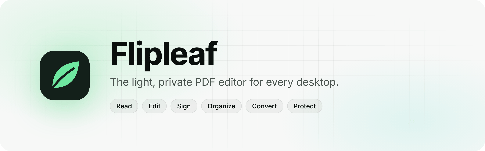
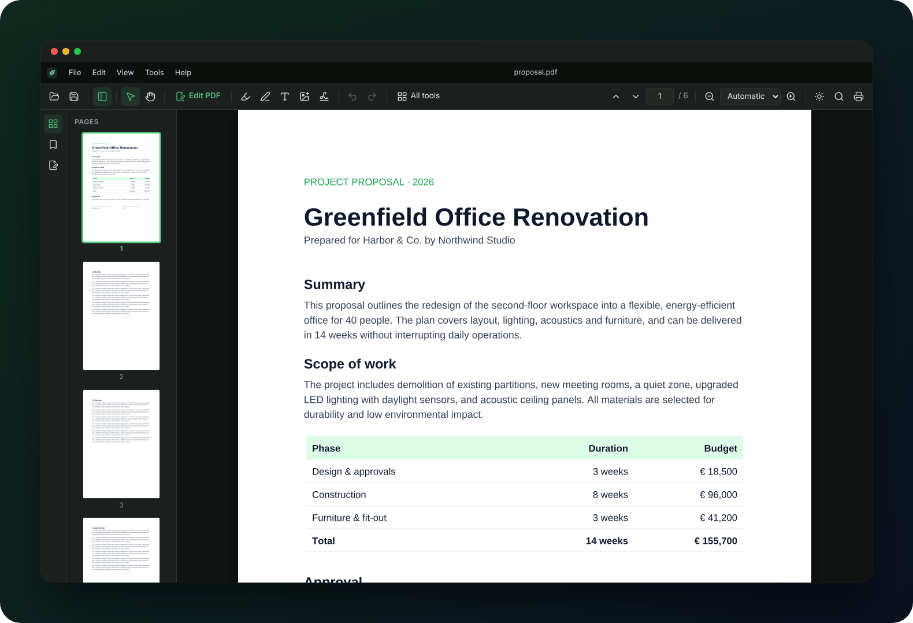
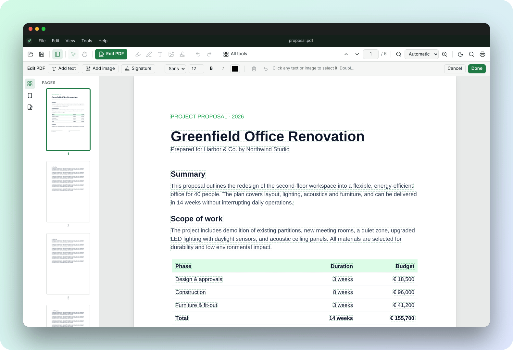
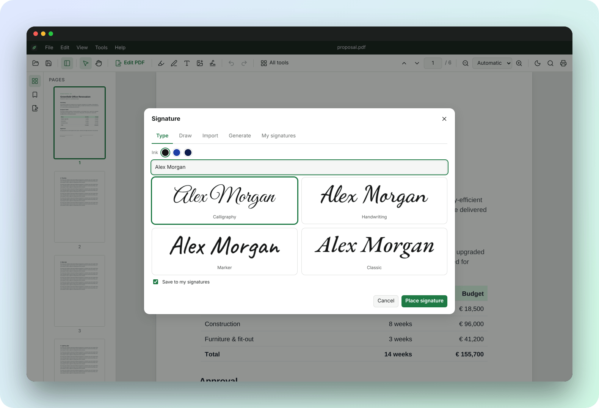
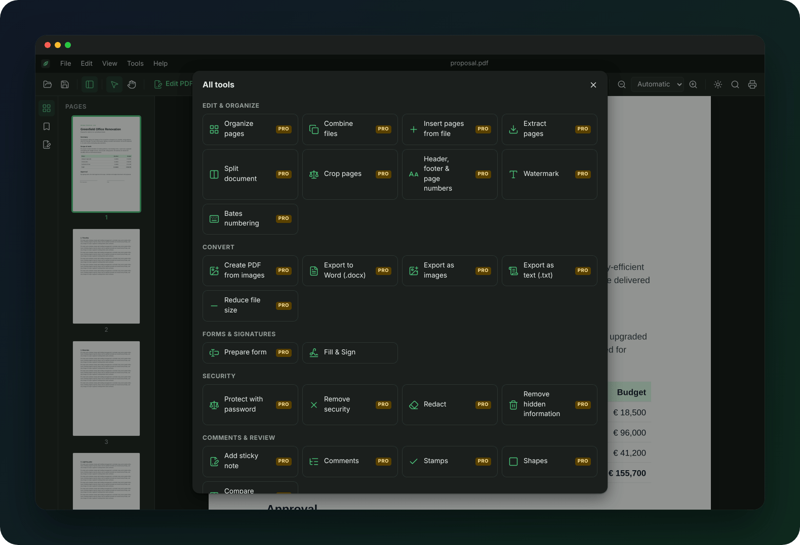
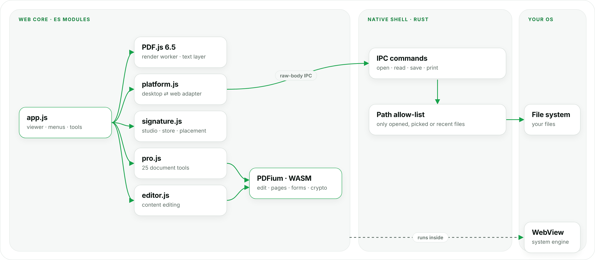

<picture>
  <source media="(prefers-color-scheme: dark)" srcset="./.github/assets/banner-dark.png">
  
</picture>

  &nbsp;
  &nbsp;
  &nbsp;
  

  
  
  
  

  <picture>
    <source media="(prefers-color-scheme: dark)" srcset="./.github/assets/stack-dark.png">
    
  </picture>

 

 

## Overview

Flipleaf is a cross-platform PDF reader and editor: a small native shell (Tauri 2 / Rust) wrapped around a web core. Mozilla's PDF.js renders the documents and Google's PDFium, compiled to WebAssembly, handles editing. It installs in seconds, starts instantly and never sends anything over the network.

|  |  |
|:--|:--|
| **~6 MB** installer | Uses the OS web engine (WebView2 / WebKit) instead of bundling Chromium |
| **0** telemetry | Strict CSP, scoped file I/O through explicit IPC commands; the only request is an optional, signed update check |
| **25** document tools | Organize, convert, forms, encryption, redaction, compare |
| **4** targets | Windows · macOS (Apple silicon + Intel) · Linux · installable PWA |
| **2** languages | English and Greek, across the UI, installers and license |

 

## Features

<table>
<tr>
<td width="33%" valign="top">

#### Read
Automatic, signed updates. Virtualized rendering, book and continuous layouts, thumbnails and outline, diacritic-insensitive search, presentation mode, read-aloud, and **light / dark themes** that follow the system or can be switched with one click. English and Greek interface, switchable from *View → Language*.

</td>
<td width="33%" valign="top">

#### Edit
Retype existing text, change font, size, style and color. Move, resize, replace and delete images. Add text, images and signatures straight into the page content.

</td>
<td width="33%" valign="top">

#### Sign
Type your name (4 script styles), draw, import a photo of your real signature with automatic background removal, or generate variations. Keep 12 signatures and place them with one click.

</td>
</tr>
<tr>
<td valign="top">

#### Organize
Reorder, rotate, delete and insert pages. Combine files in the order you choose, split, extract, crop. Add headers, footers, page numbers, watermarks and Bates numbering.

</td>
<td valign="top">

#### Convert
Images → PDF. PDF → Word (.docx), PNG/JPEG, plain text. Shrink files with three compression levels.

</td>
<td valign="top">

#### Protect
AES-256 encryption with permissions, true redaction that removes the content itself, and sanitizing of metadata and attachments.

</td>
</tr>
</table>

<table>
<tr>
<td width="50%"></td>
<td width="50%"></td>
</tr>
<tr>
<td align="center"><b>Edit PDF</b>: change the content itself, not just annotate it</td>
<td align="center"><b>Signature studio</b>: type, draw, import or generate</td>
</tr>
</table>

<b>All tools</b>: 25 document tools in one place

 

## Architecture

<picture>
  <source media="(prefers-color-scheme: dark)" srcset="./.github/assets/architecture-dark.png">
  
</picture>

<b>Data flow</b>

 

1. The OS launches Flipleaf with a file path. Rust adds the path to an allow-list and hands the UI only that file's bytes.
2. PDF.js parses the document in a Web Worker. An `IntersectionObserver` renders only the pages near the viewport.
3. A positioned text layer over each canvas provides selection, search highlights and accessibility.
4. Annotations are created with the PDF.js editors and serialized with `saveDocument()`.
5. Content edits and document tools load the bytes into PDFium. They operate on page objects (`FPDFPageObj_*`, `FPDFText_SetText`, `FPDF_ImportPagesByIndex`, `EPDF_SetEncryption`, `EPDFText_RedactInRect`), save with `SaveAsCopy`, and hot-swap the document in the viewer.
6. Save sends the bytes back over IPC. Rust writes only to allow-listed paths.

<b>Security model</b>

 

| Layer | Measure |
|:--|:--|
| Content Security Policy | `default-src 'self'`, `connect-src` limited to IPC, `script-src 'self' 'wasm-unsafe-eval'`. No remote origins |
| IPC surface | 12 purpose-built commands. No generic fs or shell plugins exposed |
| File scope | Read/write only for files the user opened, picked in a native dialog, or has in the recent list |
| Capabilities | Minimal Tauri capability set: window controls only |
| Network | The web view has none. Rust performs the optional update check against GitHub Releases; links go to the OS browser through `open_url` (http, https, mailto only) |
| Updates | Signed with an Ed25519 key (minisign); unsigned or tampered packages are rejected. Never installed without confirmation |
| Encryption | AES-256 through PDFium's standard security handler |
| Redaction | Glyphs and images inside the marked area are removed from the content stream, not covered |

Vulnerabilities: report privately, see [SECURITY.md](.github/SECURITY.md).

<b>Web / PWA build</b>

 

The same `src/` folder is deployed to GitHub Pages as an installable PWA. `platform.js` swaps the adapter: native dialogs and IPC on desktop, file picker and downloads on the web. A service worker caches the app shell for offline use. Documents never leave the browser.

 

## Tech stack

| | |
|:--|:--|
| **Shell** | [Tauri 2](https://tauri.app) · Rust · `tauri-plugin-dialog` · `tauri-plugin-opener` |
| **Rendering** | [PDF.js](https://mozilla.github.io/pdf.js/) 6.5 · CMaps · standard fonts · JBIG2 / OpenJPEG WASM decoders |
| **Editing** | [PDFium](https://pdfium.googlesource.com/pdfium/) → WebAssembly ([@embedpdf/pdfium](https://www.npmjs.com/package/@embedpdf/pdfium)) |
| **UI** | Vanilla ES modules · CSS custom properties (light/dark) · [Lucide](https://lucide.dev) icons · no framework, no bundler |
| **Formats** | PDF · DOCX (own OOXML + ZIP writer) · PNG / JPEG · TXT · ZIP |
| **Packaging** | NSIS · universal DMG · AppImage · PWA · signed auto-updates |
| **CI/CD** | GitHub Actions + `tauri-action` (4-target matrix) · GitHub Pages |

 

## Install

| Platform | Package | First launch |
|:--|:--|:--|
| **Windows** 10 / 11 | `Flipleaf-x.y.z-Windows.exe` | SmartScreen → *More info* → *Run anyway* |
| **macOS** 11+ (Apple silicon & Intel) | `Flipleaf-x.y.z-macOS.dmg` | Right-click → *Open*, or `xattr -cr /Applications/Flipleaf.app` |
| **Linux** x64 | `Flipleaf-x.y.z-Linux.AppImage` | Any distribution: `chmod +x` and run |
| **Browser** | [Open the web app](https://vasileiostripolidis.github.io/flipleaf/) | Chrome, Edge, Firefox, Safari. Installable as a PWA |

Builds are not code-signed yet, which is why the system asks once. Flipleaf registers as a handler for `.pdf`.

**Updates:** once a month (on the first launch of each month) Flipleaf checks for a new version and, if there is one, asks before installing. *Help → Check for updates…* checks any time. One click downloads, verifies and installs the signed update, then restarts. Turn automatic checks off in the Help menu. Settings and signatures are kept.

 

<b>Keyboard shortcuts</b>

 

| Keys | Action | Keys | Action |
|:--|:--|:--|:--|
| `Ctrl O` `Ctrl S` `Ctrl ⇧ S` | Open · Save · Save as | `Ctrl E` | Edit PDF |
| `Ctrl P` | Print | `Ctrl F` | Find |
| `Ctrl W` | Close | `Ctrl D` | Properties |
| `Ctrl +` `Ctrl −` | Zoom | `Ctrl 1` `0` `2` | Actual · fit page · fit width |
| `Ctrl ⇧ +` `Ctrl ⇧ −` | Rotate | `Ctrl L` | Full screen |
| `←` `→` `Home` `End` | Navigate | `V` `H` | Select · hand |
| `Ctrl Z` `Ctrl Y` | Undo · redo | `F4` | Sidebar |
| `Ctrl ⇧ Y` | Read aloud | `N` | Night reading |
| `Alt` | Menu bar | `?` | Shortcut sheet |

`⌘` replaces `Ctrl` on macOS.

 

## FAQ

<b>Is it free?</b>

 Yes, every feature, including the 25 document tools. Any future paid tier applies only to future versions.

<b>Does it phone home or expire?</b>

 No. There is no server dependency, no license check, no telemetry and no expiry date. The only network request is the optional update check, which sends nothing about you or your files.

<b>Will my edits show up in other PDF readers?</b>

 Yes. The output is standard PDF. Annotations, signatures and form data render in any compliant reader.

<b>Are the signatures legally binding?</b>

 They are image-based <i>simple electronic signatures</i> under eIDAS, not certificate-based or qualified signatures. Their legal weight depends on the document and the law that applies.

 

## Privacy & license

No accounts, analytics, crash reporting or ads. Documents, settings and signatures stay on the device. → [PRIVACY.md](legal/PRIVACY.md)

License: [All rights reserved](LICENSE) · End-user terms: [EULA.md](legal/EULA.md) · Security: [SECURITY.md](.github/SECURITY.md) · Third-party notices: [THIRD-PARTY-NOTICES.txt](legal/THIRD-PARTY-NOTICES.txt).
© Vasileios Tripolidis. The application, its code, name and logo are the property of the author (EULA §2–3). Third-party components: PDF.js (Apache-2.0), PDFium (BSD-3-Clause), EmbedPDF build (MIT), Tauri & Rust crates (MIT/Apache-2.0), Lucide (ISC), fonts (OFL-1.1).

 

## 🇬🇷 Ελληνικά

**Flipleaf**: ελαφρύ πρόγραμμα ανάγνωσης και επεξεργασίας PDF για Windows, macOS, Linux και web. Λειτουργεί εντελώς offline, χωρίς λογαριασμό και χωρίς τηλεμετρία.

- **Λήψη:** [Releases](https://github.com/vasileiostripolidis/flipleaf/releases/latest) → `…Windows.exe`, `…macOS.dmg` ή `…Linux.AppImage` · ή [έκδοση web](https://vasileiostripolidis.github.io/flipleaf/)
- **Πρώτη εκκίνηση:** Windows → *Περισσότερες πληροφορίες → Εκτέλεση οπωσδήποτε* · Mac → δεξί κλικ → *Άνοιγμα*
- **Λειτουργίες:**
  - ανάγνωση, φωτεινό/σκούρο θέμα, αναζήτηση, σχόλια
  - επεξεργασία κειμένου και εικόνων μέσα στο PDF
  - υπογραφές: πληκτρολόγηση, σχεδίαση, εισαγωγή φωτογραφίας, αυτόματη δημιουργία
  - 25 εργαλεία: οργάνωση, συνδυασμός, διαχωρισμός, μετατροπή σε Word, εικόνες ή κείμενο, συμπίεση, φόρμες, κρυπτογράφηση AES-256, redaction, σύγκριση
- **Τεχνολογία:** Tauri 2 (Rust) · PDF.js · PDFium σε WebAssembly · vanilla JS
- **Ενημερώσεις:** μία φορά τον μήνα η εφαρμογή ελέγχει για νέα έκδοση και, αν υπάρχει, την εγκαθιστά με ένα κλικ· από *Βοήθεια → Έλεγχος για ενημερώσεις…* οποιαδήποτε στιγμή
- **Απόρρητο:** τα αρχεία δεν φεύγουν ποτέ από τη συσκευή
- **Άδεια:** δωρεάν χρήση · με την επιφύλαξη παντός δικαιώματος · όροι χρήσης [EULA.md](legal/EULA.md)

 

© 2026 Vasileios Tripolidis

